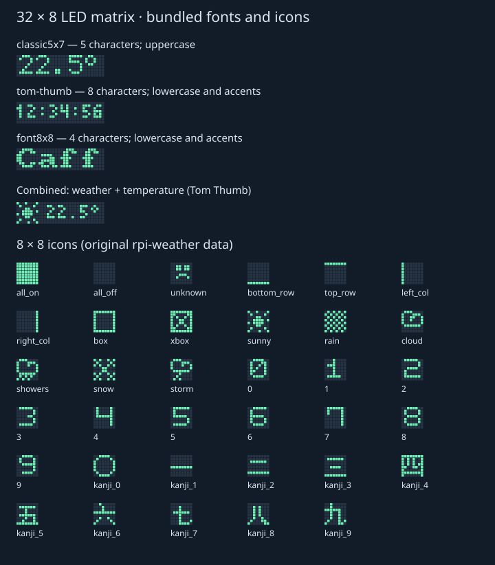

# A3 32×8 matrix tools

This feature branch supports bitmap text, icons, per-pixel calibration and RGB
frames on the tested LEDnetWF0200A3 controller. These are standalone Python tools;
they are not yet Home Assistant text or image entities.

## Hardware verification

The tested panel is 32 pixels wide and 8 high. The user visually confirmed white
`1234` with `columns-serpentine` wiring, top-left origin, the first column going
downward. A subsequent red → green → blue test confirmed ordinary RGB order.
This does not establish compatibility with all A3 firmware or other panel sizes.

The original drawing configuration was 30 pixels per segment × 10 segments.
It repeats a short pattern across the panel. Independent drawing requires
`--single-segment`, temporarily setting 256 pixels × 1 segment while preserving
IC type, channel order, and the separate music configuration (30 × 10).
This configuration write is persistent. The default behavior restores the full
backup after each timed test; `--keep-drawing` retains the drawing session after
success, allowing the next command to reuse it without rewriting the segments.
The original backup is never overwritten. Ordinary test errors trigger recovery.

Use an adequate power supply. Insufficient USB power caused flickering and
connection failures during calibration; using a power bank resolved that issue.

## Bundled fonts and icons

| Font | Cell / advance | Static characters in 32 pixels | Notes |
| --- | --- | --- | --- |
| `classic5x7` | 5×7 / 6 | 5 | Existing font; uppercase and basic punctuation |
| `tom-thumb` | 3×6 / 4 | 8 | Mostly 3×5 active glyphs; case, Latin accents, ° and € |
| `font8x8` | 8×8 / 8 | 4 | Larger letters; basic and extended Latin |

The 35 selectable 8×8 bitmap entries include six weather patterns (`sunny`, `rain`,
`cloud`, `showers`, `snow`, `storm`), digits, kanji digits, and diagnostic patterns.
They can be displayed alone or to the left of text with a one-pixel gap.
For example, an icon + `22.5°` fits using Tom Thumb. Unsupported characters and
text that exceeds the available space are rejected before Bluetooth access.
Scrolling and multicolor artwork are not implemented; the chosen RGB color
applies to both icon and text.



Sources, licenses and attribution: [assets/NOTICE.md](assets/NOTICE.md).
Original files and SHA-256 hashes are included; rendering is fully local and
uses the Python standard library. Only Bluetooth access needs `bleak`.

## Usage

Run from the repository directory with Python and, for hardware use, `bleak`.
Keep device backups and logs outside this public repository.

```bash
python tools/matrix_probe.py --list-assets
python tools/matrix_probe.py --font tom-thumb --icon sunny --text '22.5°'
python tools/matrix_probe.py --font font8x8 --text 'Èéà°'
python tools/matrix_gallery.py  # regenerate assets/preview.svg
python -m unittest discover -s tools -p 'test_matrix*.py'
```

These preview commands never connect to Bluetooth. Display on the calibrated
panel and retain drawing mode for subsequent tests:

```bash
python tools/matrix_probe.py --backup /path/to/original-backup.json \
  --count 300 --single-segment --pause-mic --variant a3-zero-tail \
  --layout columns-serpentine --font tom-thumb --icon sunny --text '22.5°' \
  --seconds 5 --keep-drawing --log-dir /path/to/captures --apply
```

The displayed temperature in this example is literal text, not a sensor reading.
`--color 255 0 0` selects red. All A3 RGB values are scaled to 20% intensity.
Omit `--keep-drawing` for automatic restoration after a test starting from the
original state. To finish a retained session, restore the saved sound mode:

```bash
python tools/matrix_restore.py --backup /path/to/original-backup.json --retry-seconds 30
```

Recovery reconnects after configuration writes because the controller may
restart Bluetooth. It verifies the exact original LED and microphone parameters
and the original mode/effect. A process/host failure or prolonged connection
loss can prevent recovery; keep the original backup available.

Calibration helpers: `--pixel-indices 0 7 8 15 16 247 248 255 --seconds 3`,
`--pixel-range 0 255`, and `--solid-cycle` (red, green, blue). Fast interval
requests are best effort: Bluetooth transport can take longer, and write delivery
alone is not proof that the physical panel displayed every frame.
